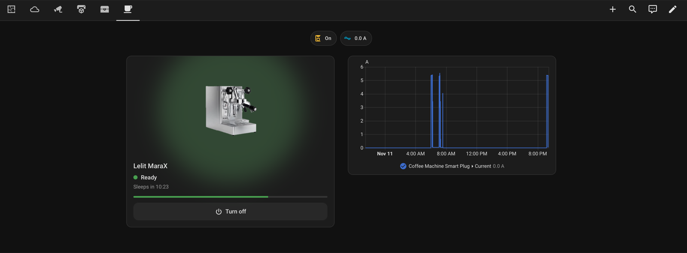
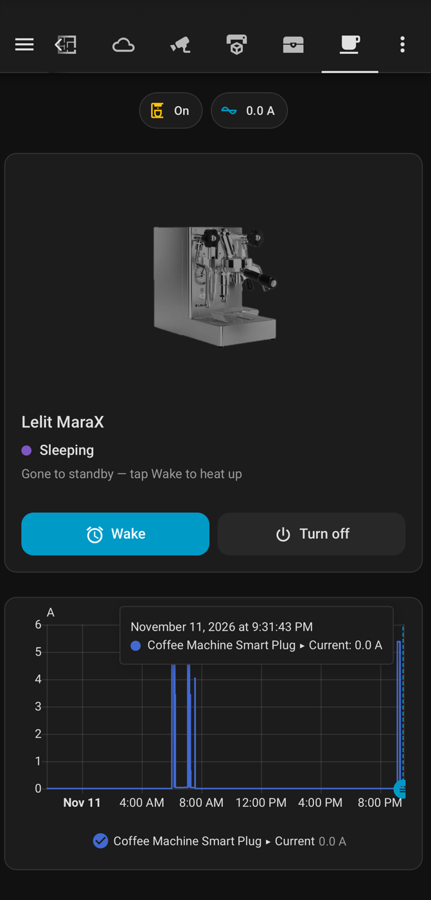
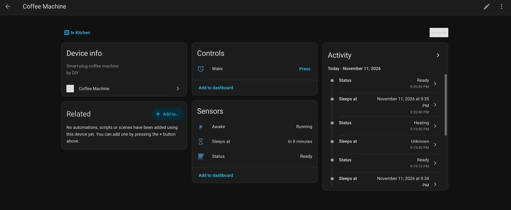

# Coffee Machine for Home Assistant

Turn any espresso machine on a smart plug into a proper Home Assistant device. The integration watches the plug's current (or power) sensor to work out whether the machine is **heating**, **ready** or **asleep**, counts down to standby, and gives you a one-tap **Wake** button and a dashboard card with a photo of your machine.

If your plug can switch the machine and report how much it's drawing, this integration works with it. It doesn't talk to the machine directly.

<p align="center">
  
</p>

<p align="center">
  
</p>

> [!WARNING]
> **This integration was written with the help of AI.** I've tested it with my own machine, but it may still have bugs or behave unexpectedly with yours. The Wake button switches a mains-powered heating appliance off and on, so keep an eye on it until you trust it. If you find a problem, please [open an issue](https://github.com/timothy-gibson/ha-coffee-machine/issues).

## Features

- **Status sensor** that shows `off`, `waking`, `heating`, `ready` or `sleeping`
- **Sleep countdown**, so you know when the machine will drop into standby
- **Wake button** that power-cycles the plug to bring a sleeping machine back to life
- **Dashboard card** with your own photo, a glow while heating, and a countdown bar while ready. It loads automatically, so you don't need to add a resource.
- Tells real heating apart from short **thermostat top-ups** and the bursts you get when **pulling shots**, so the countdown matches the machine's own timer
- Runs entirely locally. It makes no cloud or network calls and has no extra dependencies.

## Installation

### HACS (recommended)

[](https://my.home-assistant.io/redirect/hacs_repository/?owner=timothy-gibson&repository=ha-coffee-machine&category=integration)

1. Click the button above, or in HACS go to **⋮ → Custom repositories** and add `https://github.com/timothy-gibson/ha-coffee-machine` with type **Integration**.
2. Download **Coffee Machine**.
3. Restart Home Assistant.

### Manual

Copy `custom_components/coffee_machine` into your `config/custom_components/` folder and restart Home Assistant.

Requires Home Assistant **2024.12** or newer.

## Setup

[](https://my.home-assistant.io/redirect/config_flow_start/?domain=coffee_machine)

Or go to **Settings → Devices & services → Add integration → Coffee Machine**.

You can change everything later using the integration's **Configure** button.

| Setting | What it does | Default |
|---|---|---|
| **Smart plug** | The switch your machine is plugged into. | |
| **Current / power sensor** | The plug's amps or watts sensor. | |
| **Heating threshold** | A reading at or above this means the heater is on, in the same units as the sensor. On a 240 V supply a 1200 W element draws about 5 A, so 1 A (or 200 W) is a safe choice. Check the sensor's history while the machine heats to pick yours. | 1.0 |
| **Sleep timeout** | How long after its last heating or use the machine goes to standby. Match this to your machine's own standby timer. | 30 min |
| **Wake: time plug stays off** | How long the plug is switched off during a wake. | 3 s |
| **Minimum heating time** | High current shorter than this is a *burst*, not real heating. Only real heating wakes a sleeping machine. | 90 s |
| **Activity window** | A burst that starts within this long of the previous heating or burst counts as you using the machine (a shot, steaming, the reheat after it) and restarts the countdown. Isolated bursts are top-ups and are ignored. 0 turns this off. | 2 min |

## Entities

<p align="center">
  
</p>

| Entity | What it does |
|---|---|
| `sensor.<name>_status` | `off`, `waking`, `heating`, `ready` or `sleeping`. Its attributes include `heating_since`, `ready_since`, `sleep_at` and the latest reading. |
| `sensor.<name>_sleeps_at` | When the machine will go to standby (only set while ready). |
| `binary_sensor.<name>_awake` | On while the machine is heating or ready. |
| `switch.<name>_power` | Turns the smart plug on and off. |
| `button.<name>_wake` | Turns the plug off, waits a few seconds, then turns it back on. |

## Dashboard card

Add the **Coffee Machine** card from the card picker, or use YAML:

```yaml
type: custom:coffee-machine-card
entity: sensor.coffee_machine_status
name: My Espresso Machine             # optional
image: /local/coffee/my-machine.png   # optional
show_power: true                      # optional
```

To use your own photo, put it in `config/www/coffee/` and it's served at `/local/coffee/...`. A cut-out PNG with a transparent background looks best.

- The photo is grey when the machine is off or asleep, glows orange while heating and green when ready.
- While the machine is ready, a bar counts down to sleep.
- **Wake** appears when the machine is asleep, and the power button turns the plug on and off.
- Tap the photo to open the status history.

The current graph in the screenshots is a standard **History graph** card of the plug's current sensor, placed next to this card.

## How the state is worked out

```
plug off ───────────────────────────────────▶ off
plug on ────────────────────────────────────▶ waking   (waits up to 45 s for current)
current ≥ threshold after plug on ──────────▶ heating
current drops below threshold ──────────────▶ ready    (countdown starts from full)
high for ≥ minimum heating time ────────────▶ heating  (countdown cancelled)
burst within activity window of last use ──▶ ready    (countdown restarts: you're using it)
isolated burst (top-up) ────────────────────▶ no change
countdown finishes ─────────────────────────▶ sleeping
burst while sleeping ───────────────────────▶ no change (standby top-up)
real heating while sleeping ────────────────▶ heating  (woken on the machine)
```

**Example:** the machine heats up from 0:00 to 0:10. Later you make coffee: shots at 1:25, 1:26 and 1:28 each restart the countdown, so the machine shows as asleep 30 minutes after the last one, at 1:58. Isolated top-ups at 1:45, 1:50 and 1:54 are ignored.

## Automation examples

### Notify when the coffee is ready

```yaml
triggers:
  - trigger: state
    entity_id: sensor.coffee_machine_status
    to: ready
actions:
  - action: notify.mobile_app_your_phone
    data:
      message: "Coffee machine is hot ☕"
```

### Wake it on weekday mornings

```yaml
triggers:
  - trigger: time
    at: "06:30:00"
conditions:
  - condition: time
    weekday: [mon, tue, wed, thu, fri]
actions:
  - action: button.press
    target:
      entity_id: button.coffee_machine_wake
```

### Live Activity on your phone

Keeps a live notification on your phone while the plug is on. It shows the machine's state, and while the machine is ready, a countdown to sleep that ticks on the phone itself. Tapping it opens your coffee dashboard, and it's cleared when the plug turns off.

Before you use it:

1. Replace `notify.mobile_app_your_phone` with your phone's notify action. You'll find it under **Developer tools → Actions** by searching for `mobile_app`.
2. Set `dashboard_url` to the path of the dashboard view that has your coffee card.

The `live_update`, `critical_text` and `chronometer` options need a recent version of the Home Assistant Companion app.

<details>
<summary>Show the automation YAML</summary>

```yaml
alias: Coffee machine Live Activity
description: >-
  Shows the coffee machine's state as a Live Activity while the smart plug is
  on, with an on-device countdown to sleep while it's ready.
triggers:
  - trigger: state
    entity_id: sensor.coffee_machine_status
    not_to:
      - unavailable
      - unknown
actions:
  # Updates between heating and ready can arrive in quick succession while
  # you're pulling shots, so wait a little before sending to avoid flicker.
  - delay:
      seconds: >-
        {{ 20 if from_state in ['heating', 'ready'] and to_state in ['heating',
        'ready'] else 2 }}
  - variables:
      status: "{{ states('sensor.coffee_machine_status') }}"
      sleep_at: "{{ state_attr('sensor.coffee_machine_status', 'sleep_at') }}"
      looks:
        waking:
          message: Waking up…
          short: Waking
          icon: mdi:coffee-maker-outline
          color: "#FFA726"
        heating:
          message: Heating up
          short: Heating
          icon: mdi:coffee-maker
          color: "#FF7043"
        ready:
          message: Ready to brew
          short: Ready
          icon: mdi:coffee
          color: "#43A047"
        sleeping:
          message: Asleep. Tap to open and wake it
          short: Asleep
          icon: mdi:sleep
          color: "#7E57C2"
      look: "{{ looks.get(status, looks.sleeping) }}"
      payload: |-
         
          
         {{- d -}}
  - choose:
      - conditions:
          - condition: template
            value_template: "{{ status == 'off' }}"
        sequence:
          - action: notify.mobile_app_your_phone
            data:
              message: clear_notification
              data:
                tag: coffee_machine
    default:
      - action: notify.mobile_app_your_phone
        data:
          title: Coffee Machine
          message: "{{ look.message }}"
          data: "{{ payload }}"
mode: restart
variables:
  dashboard_url: /lovelace/coffee   # change to your dashboard view
  from_state: >-
    {{ trigger.from_state.state if trigger is defined and trigger.from_state is
    defined
       and trigger.from_state else 'off' }}
  to_state: >-
    {{ trigger.to_state.state if trigger is defined and trigger.to_state is
    defined
       and trigger.to_state else states('sensor.coffee_machine_status') }}
```

</details>

## Known limitations

- The countdown restarts every time the heater comes on. If your machine's own standby timer doesn't restart when it reheats, increase the sleep timeout, or rely on the next heater spike to correct the state.
- After a Home Assistant restart, a machine that's on but between heater cycles shows as sleeping until the heater next comes on.
- The state is inferred from current draw, so it's only as reliable as your plug's sensor. Plugs that report slowly (every 30 s or more) make the shot and top-up detection less accurate.

## Contributing and support

Found a bug or have an idea? Please [open an issue](https://github.com/timothy-gibson/ha-coffee-machine/issues). Include your Home Assistant version, your plug model and, if you can, a screenshot of the current sensor's history around the time it went wrong.

## License

[MIT](LICENSE)
